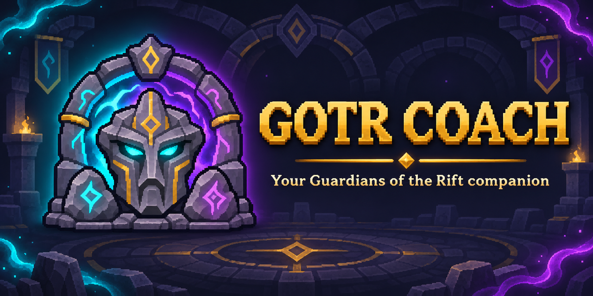
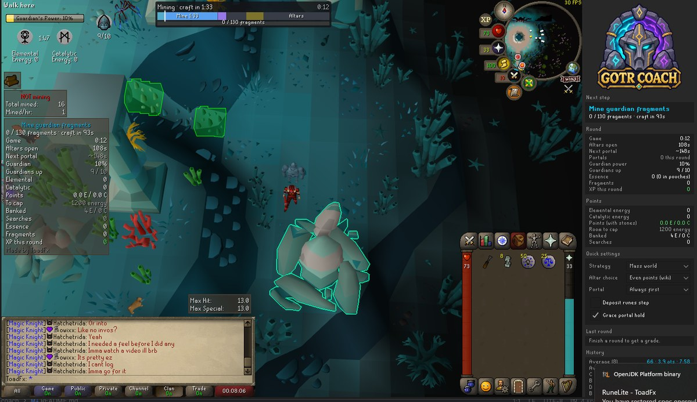
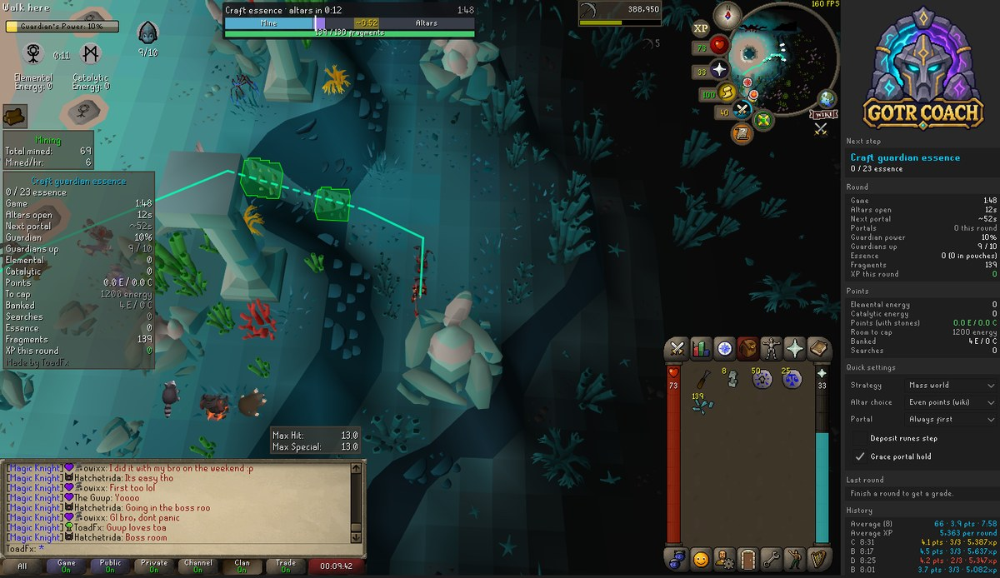
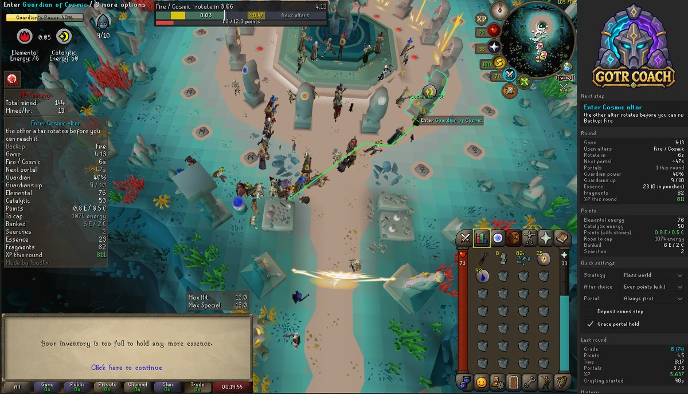
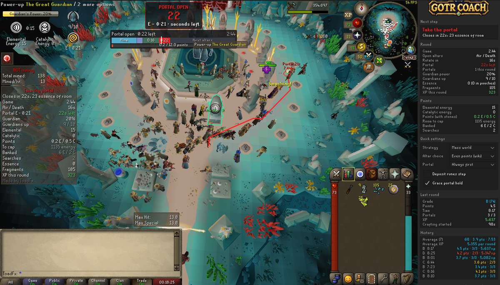
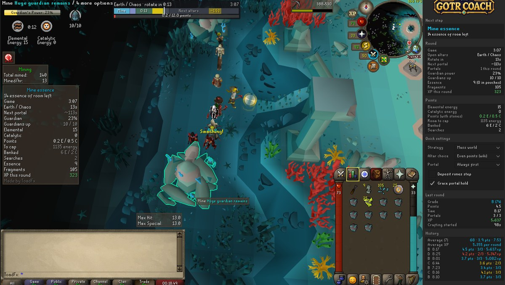
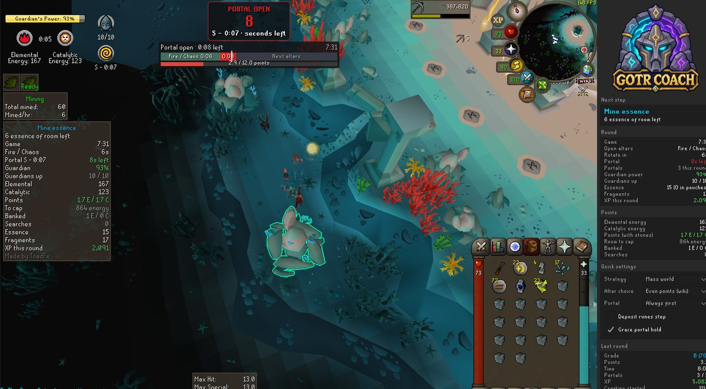
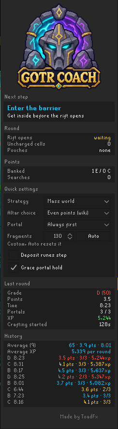
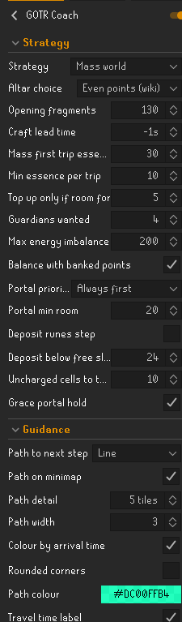
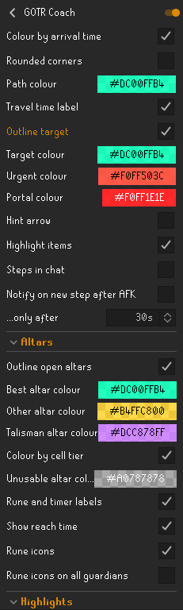

<p align="center"></p>

# GOTR Coach

A Guardians of the Rift plugin for RuneLite. It tells you the next thing to do, draws the route there, shows the whole round on one timeline bar, and grades every round against the OSRS Wiki strategy.

It only shows information. It never clicks or acts for you.

## Screenshots

**Mining phase.** The timeline counts down to when you should stop mining, and the goal bar tracks your opening fragments.



**Rubble shortcut.** With 56 Agility the route uses the rubble, drawn dashed, on the way back to the workbench.



**Heading to an altar.** The guide line follows your walk. The open altars show their rune and timer, the timeline bar sits on top, and the side panel and info panel show the round.



**Portal first.** When a portal opens, the step, path and countdown all turn red.



**Inside the huge remains.** It tells you how much room is left, and the countdown shows how long the portal stays open.





**Side panel and settings.** A sidebar tab with the next step, the round, your points, quick settings, your last grade and history. Everything is adjustable.

<table>
  <tr>
    <td align="center"><br><sub>Side panel</sub></td>
    <td align="center"><br><sub>Strategy settings</sub></td>
    <td align="center"><br><sub>Guidance and altar settings</sub></td>
  </tr>
</table>

## Features

**Step guidance**
- One clear next step in the info panel: take cells, place a cell, build a guardian, mine, craft essence, enter an altar, power up, take the portal, deposit runes, repair a barrier, and so on.
- Three wiki strategies: **Mass world**, **Team** (the wiki's general timeline) and **Solo** (single barrier between the fire and blood portals).
- Tunable: opening fragments, when to stop mining, the mass-world 30-essence first trip, guardians wanted, max energy imbalance, balance with banked points, portal priority, an optional deposit-runes step (off by default), and the grace-portal hold.

**Side panel**
- A GOTR Coach tab in the RuneLite sidebar showing the current step, the live round (altars, portal, guardian power, essence) and your points, including banked points and searches.
- Quick settings you can change mid-round: strategy, altar choice, portal priority, the deposit-runes step and the grace-portal hold.
- Your last round's grade with all its tips, plus your recent history and averages.

**Portal first**
- By default an open huge-remains portal beats everything else (stones, cells, crafting) as long as you can reach it in time and have room. It's drawn in red: path, outline, label and step.
- Prefer the old way? Set Portal priority to "Only with min room".

**Portal countdown**
- A big on-screen countdown before each expected portal: "PORTAL IN 12". It turns red and flashes for the last five seconds, then shows "PORTAL OPEN" with the seconds left and which side it's on.
- While it counts down, the planner won't send you into an altar, since you'd be stuck inside when it spawns. If your inventory and pouches are full, it still sends you, because the portal is no use then.
- Start time (15 seconds by default), text size, and whether to keep showing it once open are all adjustable. You can move it anywhere on screen.

**Path and travel time**
- A walking route to the target, drawn as a line, tiles, or both, plus the minimap if you want it. It uses the rubble shortcut if you have 56 Agility.
- The line starts at your character and moves with you every frame. Staircase zigzags are straightened out and corners are rounded.
- Travel time on the target ("9 ticks"). The path turns green, yellow or red depending on whether you'll arrive before the altar rotates or the portal closes.
- An optional hint arrow, plus an outline on the target and on the inventory items the step uses.

**Altars**
- Outlines on the open altars: the best pick, the backup, and altars you can't use (level, quest or energy cap).
- Labels show the rune, seconds until rotation, and your travel time, coloured by whether you'll make it.
- Altar choice modes: even points (wiki: Blood/Death, then Fire/Earth, then whichever type you're behind on), strict balance, best cell, most XP, elemental only, catalytic only.

**Timeline bar**
- The whole round on one bar: the mining phase, the altar phase, past portals, predicted portals, the stop-mining marker and a "now" line.
- A goal bar underneath: fragments while mining, points while crafting.
- Size, width, opacity and window length are all adjustable.

**Energy cap awareness**
- Tracks the 1,000-per-type and 1,200-total caps (1,320 with yew logs in the lantern).
- Stops sending you to an altar whose type is capped, warns when stones would go over the cap, and tells you when both types are maxed.

**Coaching**
- After every round you get a grade (S/A/B/C/D) and a score out of 100, based on your energy, when you started crafting, your first altar, portals used versus spawned, idle time and point balance.
- The top tip goes in chat. The last round, your tips and your recent average show in the panel between rounds.
- Runecraft XP per round, including the end-of-round reward: live during the round, in the chat summary, in the last-round panel, in history and as an average.
- **Personal bests:** most points, most XP, fastest round and best grade, with a "New personal best!" line in chat when you beat one. Saved per character.
- **Session stats** in the side panel: time, rounds, XP and XP per hour, points and points per hour, rounds per hour and average grade, with a reset button.
- History is saved per character.

**Ready check**
- Before the round it makes sure you have a pickaxe (worn or carried), a chisel and 10 uncharged cells. Anything missing becomes the next step, shows in the panels, and is added to the round-start alert.

**Quality of life**
- Hides Power-up without stones and Place-cell without a cell.
- Inactive and locked guardians never take the left click. Neither does the Great Guardian while you're holding a cell.
- When you reach your opening fragments: a big green "FRAGMENTS REACHED" banner for a few seconds, and your fragment stack flashes green in the inventory until you start crafting.
- A warning before the next portal spawns (15 seconds by default, adjustable).
- Notifications for the round starting, the altars opening, a portal, reaching your fragment target, chosen altars opening, hitting the energy cap, and a pouch needing repair.
- Banked reward points and the searches you can afford.

## Building

Open the folder in IntelliJ and run `GotrCoachPluginTest` (in `src/test`). Or run:

```
./gradlew run
```

Unit tests cover the planner, altar choice, energy maths, HUD parsing and grading:

```
./gradlew test
```

## Credits

Strategy and numbers come from the [OSRS Wiki](https://oldschool.runescape.wiki/w/Guardians_of_the_Rift/Strategies). Built on [RuneLite](https://runelite.net).

Made by ToadFx.
